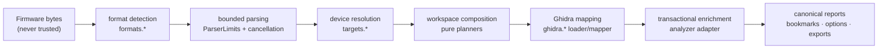

# Embedra

[](LICENSE)
[](https://ghidra-sre.org/)
[](https://openjdk.org/projects/jdk/21/)

**Embedra** is a high-assurance Ghidra extension for embedded-firmware reverse
engineering, hardware CTF analysis, cryptographic artifact recovery, and
silicon security analysis. It turns validated firmware bytes into Ghidra
programs with plan-checked memory maps, device-identity enrichment, and
security-findings reporting — never guesses, never silently promotes a
planned capability to a working one.

Embedra currently implements comprehensive support components for **Espressif
(ESP32 family full-flash across 14 series, legacy ESP8266)**, **Raspberry Pi
(RP2040 / RP2350 / RP2354)**, **STMicroelectronics (STM32 MCU curated catalog;
STM8 8-bit MCU family)**, **Nordic Semiconductor (nRF51, nRF52, nRF53, nRF91
series)**, and **Atmel / Microchip (classic megaAVR, tinyAVR, modern AVR-Dx,
32-bit SAM Cortex-M)** per the capability states in the support matrix.
Support states are exact: part/format/feature combinations are `PLANNED`,
`EXPERIMENTAL`, `VERIFIED`, or `UNSUPPORTED`, and are only documented when
backed by tests in this repository.

---

## Table of Contents

- [Documentation](#documentation)
- [Core Capabilities](#core-capabilities)
- [Architecture Summary](#architecture-summary)
- [Capability States (What Is Actually Supported)](#capability-states-what-is-actually-supported)
- [Cryptographic Analysis Engine](#cryptographic-analysis-engine)
- [YARA Pattern Matching & Threat Hunting](#yara-pattern-matching--threat-hunting)
- [Security Leads & CTF Recovery](#security-leads--ctf-recovery)
- [Unified Findings, UI & Secret Redaction](#unified-findings-ui--secret-redaction)
- [Firmware & Workspace Diffing](#firmware--workspace-diffing)
- [Local Scanner Plugin API](#local-scanner-plugin-api)
- [Installation](#installation)
- [Quickstart](#quickstart)
- [User Guide & Workflows](#user-guide--workflows)
- [Troubleshooting & Diagnostics](#troubleshooting--diagnostics)
- [Building from Source](#building-from-source)
- [Known Limitations](#known-limitations)
- [Governance & Non-Negotiable Invariants](#governance--non-negotiable-invariants)
- [Security & Support](#security--support)

---

## Documentation

The complete documentation suite lives in this repository:

| Document | Purpose |
|---|---|
| [`docs/architecture.md`](docs/architecture.md) | Enforced package boundaries and the implemented import pipeline |
| [`docs/headless.md`](docs/headless.md) | `analyzeHeadless` operation: flags, loaders, analyzers, JSON export |
| [`docs/troubleshooting.md`](docs/troubleshooting.md) | Stable diagnostic codes and symptom→fix guidance |
| [`docs/support-matrix.md`](docs/support-matrix.md) | Every earned capability state, with evidence links |
| [`docs/compatibility-matrix.md`](docs/compatibility-matrix.md) | Compatibility by Ghidra release, OS, device, format, pack, detector |
| [`docs/device-catalog.md`](docs/device-catalog.md) | Querying catalogs and adding devices without silent drift |
| [`docs/crypto-coverage.md`](docs/crypto-coverage.md) | Crypto detector suite, algorithms, measured FP rates, confidence model |
| [`docs/pack-format.md`](docs/pack-format.md) | Offline pack manifests, installation, and selection semantics |
| [`docs/fixture-policy.md`](docs/fixture-policy.md) | Fixture provenance, deterministic generators, private fixtures |
| [`docs/agent-handoff.md`](docs/agent-handoff.md) | AI-agent continuity protocol for working on this repository |
| [`LICENSE`](LICENSE) · [`NOTICE`](NOTICE) · [`THIRD_PARTY_NOTICES.md`](THIRD_PARTY_NOTICES.md) | Licensing and redistribution information |
| [`SECURITY.md`](SECURITY.md) | Vulnerability disclosure policy |
| [`CONTRIBUTING.md`](CONTRIBUTING.md) | How to contribute and which quality gates apply |
| [`CODE_OF_CONDUCT.md`](CODE_OF_CONDUCT.md) | Community standards |
| [`CHANGELOG.md`](CHANGELOG.md) | Milestone summary redrawing from evidence |

Architectural decision records live under [`docs/adr/`](docs/adr/).

---

## Core Capabilities

- **Zero-Guess Firmware Ingestion**:
  - Firmware formats are identified from structural byte validation, never
    from filenames — every rejection is a typed, stable diagnostic code.
  - ESP32-S3 full-flash captures are dissected into multi-program workspaces:
    bootloader, populated application slots, and explicit artifact
    classification for erased slots and data partitions (NVS/PHY/filesystem
    regions are detected and classified, not decoded).
  - Statically validated container formats: UF2 multi-block payloads, Intel
    HEX, Motorola S-Record, raw memory binaries, DfuSe v1, and ESP8266 legacy
    v1/v2 images.
- **Execution Topology & Hardware Mapping**:
  - Multi-core architectures modeled as validated graphs: symmetric SMP,
    heterogeneous dual-core, radio coprocessors, TrustZone secure/non-secure
    worlds, application/network core splits.
  - Memory-mapped peripheral (MMIO) enrichment via verified, provenance-pinned
    CMSIS-SVD packs; ROM symbol attribution; vector-table reconstruction.
  - Function ABI normalization for unknown conventions (feature row in
    `docs/support-matrix.md`).
- **Layered Cryptographic Artifact Recovery**:
  - Seven independent detector subsystems (constants tables, library
    signatures, hardware peripherals, vendor ROM APIs, key material,
    entropy, fused pipeline) with corpus-measured precision/recall and
    explicit unsupported-case tracking.
  - Strict differentiation prevents non-crypto tables (CRCs, Base64,
    Deflate/zlib, LZ4) from ever being misclassified as encryption (AN-003).
  - Cross-program key handoff and call-site corroboration engines.
- **Security Leads, Logging & Panic Recovery**:
  - Assertion strings, panic sites, format strings, and call-site arguments
    recovered across Thumb, RISC-V, and Xtensa.
  - Ranked leads: authorization branch decisions, hardcoded credential
    comparisons, debug shells, and OTA update endpoints.
- **Unified Findings Management**: interactive Swing table with filtering,
  suppression rules, bookmark synchronization, and JSON/Markdown/SARIF
  export — with zero-leak secret masking (`[REDACTED_SECRET]`) enforced by
  default (AN-008).
- **Firmware Workspace Diffing**: multi-view comparison across functions,
  symbols, strings, metadata, memory blocks, and partition layouts.
- **Sandboxed Local Plugin API**: declarative JSON manifests, bounded
  matchers, wall-time/allocation budgets, and ReDoS/infinite-loop containment
  (T063, T068).

---

## Architecture Summary

Embedra separates pure analysis engines (no Ghidra dependencies) from a thin
Ghidra adapter layer — a boundary enforced on every build by
`ArchitectureBoundaryTest` and described in detail in
[`docs/architecture.md`](docs/architecture.md):



Pure packages: `core`, `formats`, `targets`, `analyzers`, `pack`, `svd`.
The Ghidra adapter (`ghidra.*`) performs loaders, mappers, services, UI,
and one transaction per logical program — rollback on failure, user state
preserved (T072/T069).

---

## Capability States (What Is Actually Supported)

| Family | Implemented behavior | State | Evidence |
|---|---|---|---|
| ESP32 family (14 series in the catalog) | Application-image & multi-slot full-flash import, memory/entry planning, topologies, opt-in ROM/peripheral/SVD packs with per-device availability | `VERIFIED` full-flash & core rows; `EXPERIMENTAL` per chip-ID provider | `docs/support-matrix.md` |
| ESP32-S3 (image chip ID 9) | Parsing, mapping, `esp_app_desc_t` metadata, full-flash partition workspace, FID pilot, SVD enrichment | `VERIFIED` subset rows + `EXPERIMENTAL` rows (e.g., language ISA breadth) | `docs/support-matrix.md` |
| ESP8266 legacy (EX/8285) | v1/v2 image parsing and import in a separate provider | `EXPERIMENTAL` | `docs/support-matrix.md` |
| Raspberry Pi RP2040/RP2350/RP2354 | UF2 parse `VERIFIED` + reconstruction `EXPERIMENTAL`; loader/imports; board profiles; PIO analyzer | `EXPERIMENTAL` (planning-pure subset rows marked) | `docs/support-matrix.md` |
| STM32 (53 curated exact parts, 20 families) | Catalog identity (VERIFIED catalog lookup), import components per format (ELF/HEX/DfuSe/BIN), vector confirmation, SVD subset (8 parts), TrustZone planning, dual-core/wireless/external-memory planning | `EXPERIMENTAL` components; device-support states stay `PLANNED` | `docs/support-matrix.md` |
| STM32MP1/MP2 | DTS-based topology planning, boot chain, heterogeneous cores | `EXPERIMENTAL` pure planning | T049 |
| STM8 (32 curated parts, 4 families: STM8S, STM8L, STM8A, STM8T) | Multi-format decoding (BIN/HEX/S19/ELF), Harvard/linear memory mapping, 4-byte vector tables, peripheral packs, runtime signatures; 8 parts promoted | `SUPPORTED` (8 verified parts) / `PLANNED` (24 parts) | `docs/compatibility-matrix.md` §4.2 |
| Nordic Semiconductor nRF (21 curated parts: nRF51, nRF52, nRF53, nRF91) | Multi-format decoding (BIN/HEX/ELF), MBR/SoftDevice/App/Bootloader alignment, nRF5340 dual-core IPC, nRF9160 TrustZone, peripheral packs, nRF5/Zephyr signatures; 5 parts promoted | `SUPPORTED` (5 verified parts) / `PLANNED` (16 parts) | `docs/compatibility-matrix.md` §4.3 |
| Atmel / Microchip (27 curated parts: ATmega, ATtiny, AVR-Dx, SAMD, SAME) | Multi-format decoding (BIN/HEX/ELF), separate Harvard address spaces, unified AVR-Dx window, SAM Cortex-M linear maps, Optiboot/SAM-BA bootloaders, ATDF/SVD packs, fuse decoders, Arduino/ASF signatures; 5 parts promoted | `SUPPORTED` (5 verified parts) / `PLANNED` (22 parts) | `docs/compatibility-matrix.md` §4.4 |

A capability is listed here only because tests in this repository prove it;
see the matrices for the exact per-row evidence (requirement-to-evidence
indexing: `.embedra/evidence/evidence-index.json`).

---

## Cryptographic Analysis Engine


### Supported primitives and detection layers

- **Symmetric ciphers targeted by table/signature layers**: AES (128/192/256,
  S-boxes/Rcon), DES/3DES permutations, ChaCha20 constants.
- **Asymmetric/curve constants**: RSA key structures, NIST P-256, secp256k1,
  Curve25519/Ed25519 search terms.
- **Hashes & MACs**: MD5, SHA-1/224/256/384/512 tables, SHA-3/Keccak constants
  (rule sets), BLAKE2 rule coverage, HMAC analysis, CMAC/HKDF/PBKDF2 rule
  and search-term coverage.
- **Hardware security detection**: AES/SHA/RSA/DS/HMAC/RNG/eFuse MMIO
  accesses, secure-element I2C identification, flash-encryption and
  secure-boot engine indicators — all evidence-gated leads (AN-013).
- **Strictly non-encryption categories**: CRC-32/16/8, Adler-32, Fletcher-16
  checksums; Base64/Deflate/zlib/LZ4 encoding/compression tables.

Measured per-detector precision/recall/false-positive behavior on the
deterministic T066 corpus (100%/100%/0% corpus, gated ≥90%/≥90%/≤5%) and the
confidence ladder (`CONFIRMED`, `LIKELY`, `PLAUSIBLE`, `LEAD`) are documented
in [`docs/crypto-coverage.md`](docs/crypto-coverage.md). These are corpus
measurements, not guarantees about arbitrary firmware (AN-014).

### Provenance-checked signature taxonomy

The signature subsystem recognizes an 11-library embedded-crypto taxonomy
(`mbed TLS / PSA Crypto`, `wolfSSL`, `BearSSL`, `TinyCrypt`, `Monocypher`,
`micro-ecc`, `LibTomCrypt`, `OpenSSL`, `ESP-IDF`, `STM32 HAL`, `Pico SDK`)
and applies signatures only when target architecture, compiler, optimization
level, and artifact role evidence is recorded (T064). The shipped signature
pack today is the STM32 F1 slice; other libraries apply only with
caller-supplied provenance-checked packs.

---

## YARA Pattern Matching & Threat Hunting

Embedra embeds a pure-Java YARA-compatible compiler and scanning engine for
embedded-firmware pattern identification:

- **Analysis priority**: the YARA analyzer runs at
  `AnalysisPriority.DATA_ANALYSIS`, tagging threat indicators and container
  boundaries before lower-priority heuristic analyzers run.
- **Bundled rule sets** (`rules/threats/`, `rules/formats/`, `rules/crypto/`):
  - Threats & malware families (Mirai command dispatch, Gafgyt/Bashlite,
    Mozi P2P), ARM Thumb `execve("/bin/sh")` shellcode idiom, hardcoded
    telnet backdoor, reverse shells, hidden UART debug consoles.
  - Container/filesystem recognition: SquashFS, CramFS, JFFS2, UBIFS, YAFFS2,
    ZIP, TAR, GZIP; encodings (Base64/Base32/Hex).
  - Crypto table detection: AES S-boxes and Rcon, DES permutations, Blowfish,
    ChaCha20 constants, MD5/SHA-1/SHA-256/SHA-512 constants, Keccak round
    constants, CRC tables.
- **Custom rules directory**: point
  `Edit → Tool Options → Analyzers → Embedra YARA Analysis → Custom Rules
  Directory` at your own `.yar`/`.yara` files.
- **Integration**: YARA findings merge into `CryptoTableDatabase.withYara()`
  and `CryptoAnalysisPipeline.withYara()`, and `MALWARE`/`BACKDOOR` matches
  raise `WARNING` bookmarks and EOL annotations.

---

## Security Leads & CTF Recovery

Embedra extracts actionable security leads from disassembled instructions and
control flow without speculative claims (AN-004, AN-005):

- **Comparison leads**: tracks call sites to `strcmp`/`strncmp`/`memcmp`/
  constant-time comparators where operands reference sensitive tokens
  (`password`, `admin`, `secret`, `token`, `pin`, `key`, `flag`); constant-time
  comparisons are identified as such.
- **Authorization branches**: inspects conditional branches following
  comparisons (`cbz`, `cbnz`, `beq`, `bne`, `beqz`, `bnez`) to surface
  access-control gating decisions.
- **Debug & admin commands**: discovers CLI dispatch tables
  (`{ name, handler, help }`) with administrative keywords, interactive
  shell prompts, and console-init symbol corroboration.
- **OTA endpoints**: firmware download URLs, MQTT update topics, update
  partition references.
- **Panic & assertion recovery**: assert/panic signatures, source paths, line
  numbers, termination traps, and backward call-site argument resolution
  (ARM Thumb `r0-r3`, RISC-V `a0-a7`, Xtensa `a2-a7`/windowed calls).
- Leads are ranked (`HIGH`/`MEDIUM`/`LOW` confidence). Leads never prove
  exploitability.

---

## Unified Findings, UI & Secret Redaction

All discovered entities feed a unified reporting architecture (AN-006,
AN-008):

- **Findings Window** (`Window → Embedra → Unified Findings`):
  column sorting, category/severity filtering, free-text search,
  double-click navigation, suppression/unsuppression with
  `[SUPPRESSED: reason]` annotations, and bidirectional bookmark
  synchronization.
- **Secret redaction (AN-008)**: keys, tokens, and flags are masked by
  default (`4a2f****************************` / `[REDACTED_SECRET]`)
  across logs, bookmarks, and exports; unmasked output exists only as an
  explicit request, and masked views are toggle-independent.
- **Exports**: JSON, Markdown tables, and SARIF 2.1.0 for CI/CD pipelines.

---

## Firmware & Workspace Diffing

`Window → Embedra → Firmware Workspace Diff` (AN-007):

- Compare two loaded Ghidra programs side-by-side with a multi-view panel:
  function diffs (identical/modified/unique by entry and instruction
  hashing), symbol diffs, string diffs, memory/permission diffs, and
  metadata/partition diffs.
- Filter by change status `ADDED`, `REMOVED`, `MODIFIED` (and `MOVED`/
  `UNCHANGED` views from the engine), with secret-masking toggles and
  export actions (`EmbedraDiffPlugin`).

---

## Local Scanner Plugin API

Custom inspection scanners run in a safe local plugin contract (AN-009):

- **Declarative manifests**: schema-validated
  (`urn:embedra:schema:scanner-plugin-manifest:1`) JSON files.
- **Matchers**: `REGEX` (ReDoS-bounded), `HEX_BYTES` with wildcards,
  `EXACT_STRING`, `ENTROPY` windowed scanning.
- **Sandboxed execution**: configurable wall-time timeouts, allocation
  limits, finding caps; hostile loops, `OutOfMemoryError`, and
  `StackOverflowError` are trapped without destabilizing Ghidra (T063,
  per-plugin budgets per T068).

---

## Installation

### Prerequisites

- **Ghidra** **12.1.3 PUBLIC** (pinned baseline; Byte-level loader and
  analyzer compatibility is earned per release — see
  [`docs/compatibility-matrix.md`](docs/compatibility-matrix.md)).
- **Java**: a 64-bit **JDK 21** runtime for Ghidra itself.

### Steps

1. Obtain or build an extension ZIP:
   `dist/ghidra_12.1.3_PUBLIC_YYYYMMDD_Embedra.zip` (the filename encodes
   the compatible Ghidra line; the release bundle carries a SHA-256
   checksum to verify before installing).
2. Launch Ghidra.
3. `File → Install Extensions...`.
4. Click the green `+` (Add extension), select the ZIP.
5. Check **Embedra** and restart Ghidra when prompted.

For headless installation and `analyzeHeadless` recipes, see
[`docs/headless.md`](docs/headless.md).

---

## Quickstart

**GUI, first ESP32-S3 import:**

1. `File → Import File...` and select a full-flash capture or application
   image. The Embedra loader validates the format from bytes — not name.
2. Review the import options: extraction of sub-programs (bootloader/app
   slots), and — only when your silicon target is exactly the pinned pack
   revision — enable `Apply verified target ROM, peripheral, and SVD packs`.
3. Run automatic analysis (`Analysis → Auto Analyze`). Embedra analyzers run
   by default; open `Window → Embedra → Unified Findings` and the
   CodeBrowser bookmarks/EOL comments for results.

**Headless, first RP2040 import:**

```bash
$GHIDRA_INSTALL_DIR/support/analyzeHeadless \
    /tmp/embedra-project projA \
    -import path/to/firmware.uf2 \
    -log run.log -scriptlog script.log
```

See `docs/headless.md` for loader names, `-loader-` options, export scripts,
and CI recipes.

---

## User Guide & Workflows

### Importing firmware images

- **Full flash binary (ESP32 family)**: import raw full-flash dumps across 14 ESP32 series; Embedra validates partition tables (with MD5 checks), classifies bootloader/app/artifact slots, maps execution topologies, and preserves unmapped flash artifacts.
- **UF2 firmware (RP2040/RP2350/RP2354)**: all block checksums and family IDs are validated; binary-info markers, board profiles, boot metadata, and — where fingerprints warrant — components (TinyUSB, lwIP, CYW43439) and PIO programs are annotated.
- **STM32 ELF/HEX/BIN**: import through Ghidra's native loaders, then apply Embedra STM32 components by selecting the exact catalog part and supplying the base; confirmation and enrichment are explicit user-supplied identities and addresses.
- **STM8 (S/L/A/T) BIN/HEX/S19/ELF**: import classic 8-bit STM8 firmware; validates 4-byte vector tables (opcode `0x82`), maps unified address spaces, links peripheral packs, and recognizes compiler/SPL library signatures.
- **Nordic nRF (51/52/53/91) HEX/BIN/ELF**: import wireless multi-image firmware; validates MBR, SoftDevice, application, and bootloader boundaries, maps nRF5340 dual-core IPC channels, separates nRF9160 TrustZone domains, and enriches nRF5/Zephyr BLE runtime signatures.
- **Atmel / Microchip (AVR/SAM) HEX/BIN/ELF**: import Harvard classic AVR (separate `code`/`mem`/`eeprom`/`io` spaces), unified AVR-Dx flash windows, or 32-bit linear SAM Cortex-M firmware; validates 2-byte/4-byte vector tables, decodes fuses, handles Optiboot/SAM-BA bootloaders, and recognizes Arduino/ASF runtime signatures.
- **ESP8266 legacy images** import only through the dedicated legacy loader; a version 2 image requires the confirmed flash base option.

### Analyzer configuration

`Analysis → Auto Analyze '<Program>'...` exposes our analyzers:

- `Embedra Layered Crypto Analysis` — constants, signatures, hardware, ROM,
  keys, entropy, fusion.
- `Embedra Logging & Diagnostics Recovery` — format strings, assert/panic
  reconstruction.
- `Embedra Security Leads Discovery` — comparisons, branches, shells, OTA.
- `Embedra CTF & Entity Discovery` — endpoints, credentials, certificates,
  UUIDs, blobs, flags.
- `Embedra String & Stack-String Recovery` — multi-encoding strings and
  stack-constructed strings.
- `Embedra YARA Pattern Analysis` — bundled + custom rules at
  `DATA_ANALYSIS` priority.
- `Embedra Function ABI & Signature Normalizer` — ABI normalization.
- `Embedra Local Scanner Plugins` — sandboxed local plugin scanning.
- ESP32-S3 programs add `Embedra ESP32-S3 Crypto Evidence` and the opt-in
  `Embedra ESP32-S3 Function ID` pilot.
- STM32 programs add vector/SVD/external-memory applicators after explicit
  exact-part selection.

### Reviewing findings & exporting

1. `Window → Embedra → Unified Findings`; filter, search, or double-click to
   navigate.
2. Suppress false positives with a reason; re-enable any time.
3. `Export` results as JSON, Markdown, or SARIF 2.1.0 (redaction enabled).
4. Use `Window → Embedra → Firmware Workspace Diff` for two-image
   comparisons, including multi-program workspace topology facts.

---

## Troubleshooting & Diagnostics

Failure messages carry stable machine-readable codes. The symptom → cause →
fix catalog (malformed inputs, memory-map conflicts, missing SVD packs,
TrustZone apertures, headless errors, resource budgets) lives in
[`docs/troubleshooting.md`](docs/troubleshooting.md). The enforced
pure/adapter architecture and pipeline internals are in
[`docs/architecture.md`](docs/architecture.md).

---

## Building from Source

Embedra uses the checked-in Gradle wrapper (9.6.1) with fully offline,
reproducible packaging (`gradle.lockfile` pins resolved dependencies).

### Environment

```bash
export JAVA_HOME=/path/to/openjdk-21        # exact JDK 21 baseline
export GHIDRA_INSTALL_DIR=/path/to/ghidra_12.1.3_PUBLIC
```

### Build commands

```bash
# Ghidra-independent pure unit and analyzer suite
./gradlew pureTest

# Full quality gate (Checkstyle, unit tests, real-Ghidra integration
# tests, JaCoCo coverage, catalog generator suites, license audit,
# documentation link audit)
./gradlew check

# Build the Ghidra extension ZIP (byte-reproducible)
./gradlew buildExtension

# Two-run reproducible packaging and release-gate audit
bash scripts/verify-build-quality.sh

# Release-bundle side artifacts (T078): extract dist/embedra-src.zip,
# generate the deterministic CycloneDX 1.5 SBOM (dist/embedra-sbom.json),
# and write the sha256sum-compatible checksum manifest (dist/SHA256SUMS)
bash scripts/build-release-artifacts.sh dist/ghidra_12.1.3_PUBLIC_YYYYMMDD_Embedra.zip
```

`scripts/verify-build-quality.sh` rebuilds the ZIP twice (fully offline,
`--offline`), requires byte-identical SHA-256 artifacts (the deterministic
ZIP-entry oracle pins exact contents), runs the license audit against the
archive, and then builds and fail-closed-audits the release supply-chain
bundle. A downloaded release verifies with `sha256sum -c dist/SHA256SUMS`;
the SBOM covers the shipped jar, the Ghidra host platform, every offline
data bundle, and every Gradle-locked build-time component (recorded
`excluded`, never bundled). Dependency resolution is additionally pinned by
`gradle/verification-metadata.xml` (SHA-256 for every resolved artifact) on
top of `gradle.lockfile`.

---

## Known Limitations

- Only Linux x86-64 is a verified clean-build/host platform; Windows and
  macOS remain planned pending their own install/headless evidence
  (`docs/compatibility-matrix.md`).
- STM32 device-support states are all `PLANNED`; STM32 import components are
  `EXPERIMENTAL` with reviewed subsets (8-part SVD subset, reviewed board
  profiles, F1 signature slice).
- STM8, Nordic nRF, and Atmel / Microchip families have verified representative
  parts promoted to `SUPPORTED` (8 STM8, 5 Nordic nRF, 5 Atmel/Microchip parts),
  with remaining cataloged parts held in `PLANNED` status pending individual golden fixture evidence.
- Whole-program decompiler-driven call graphs, symbolic data flow, and taint
  analysis are planned, not implemented; crypto call-site engines are bounded.
- Crypto metrics are corpus measurements (deterministic synthetic corpora),
  explicitly not guarantees on arbitrary production firmware (AN-014), with
  four tracked unsupported-case classes in `docs/crypto-coverage.md`.
- No screenshots are committed in this repository yet; user-facing imagery
  will appear only from working release-gate builds (T112 convergence).

---

## Governance & Non-Negotiable Invariants

1. **Specification authority**: `Embedra-SpecKit.md` is the sole source of
   truth; task states and digests are tracked deterministically in
   `.embedra/state.json` (see `docs/agent-handoff.md`).
2. **Pure/adapter separation**: pure analyzers never import `ghidra.*`;
   enforced by `ArchitectureBoundaryTest` on every build.
3. **Bounded execution**: shared `ParserLimits` and resource budgets with
   cooperative cancellation across parsers, scanners, and applicators.
4. **Non-destructive modification**: applicators preserve user-defined
   symbols, primary names, and comments; rollback on any failure.
5. **Zero secret leaking**: secrets are masked by default in reports, logs,
   bookmarks, and exports (AN-008).
6. **Bit-for-bit reproducibility**: builds produce deterministic,
   byte-identical extension archives with pinned entry inventories.
7. **Evidence-based claims**: capability states are exact; documents may
   only advertise what tests prove (`docs/support-matrix.md`).

---

## Security & Support

- Vulnerability disclosure: [`SECURITY.md`](SECURITY.md) (private reporting;
  no public issues for suspected vulnerabilities).
- Contribution guide and quality gates: [`CONTRIBUTING.md`](CONTRIBUTING.md).
- Community standards: [`CODE_OF_CONDUCT.md`](CODE_OF_CONDUCT.md).
- Operating questions: [`docs/headless.md`](docs/headless.md),
  [`docs/troubleshooting.md`](docs/troubleshooting.md), and
  [`docs/support-matrix.md`](docs/support-matrix.md) define what support
  requests can reasonably claim.

---

## License

Embedra is licensed under the **Apache License, Version 2.0**. See
[LICENSE](LICENSE) for details; third-party attribution and redistribution
boundaries are recorded in [NOTICE](NOTICE) and
[THIRD_PARTY_NOTICES.md](THIRD_PARTY_NOTICES.md) (audited ledger in
[`docs/license-audit.md`](docs/license-audit.md)).
