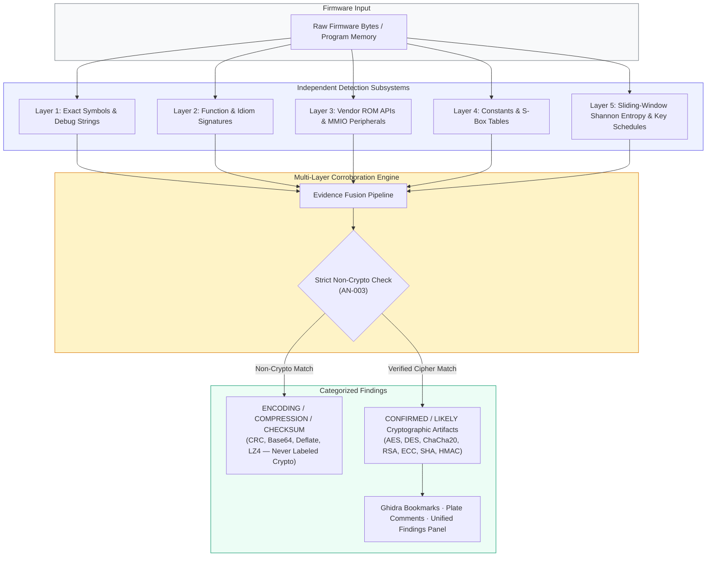

# Embedra

<div align="center">

[](LICENSE)
[](https://ghidra-sre.org/)
[](https://openjdk.org/projects/jdk/21/)
[](scripts/verify-build-quality.sh)
[](dist/embedra-sbom.json)
[](scripts/scan-secrets.py)

**High-Assurance Embedded Firmware Reverse Engineering & Silicon Security Analysis for Ghidra**

[📦 Installation](#installation) • [⚡ Quickstart](#quickstart) • [🎯 Target Matrix](#capability-states-what-is-actually-supported) • [🏗️ Architecture](#architecture-summary) • [📚 Documentation](#documentation)

</div>

---

**Embedra** is a high-assurance Ghidra extension purpose-built for embedded-firmware reverse engineering, hardware CTF recovery, cryptographic artifact discovery, and silicon security analysis. It turns raw, unverified firmware bytes into fully structured Ghidra programs equipped with plan-checked memory layouts, vector-table annotations, peripheral register models, and evidence-gated security findings.

> [!IMPORTANT]
> **Strict Non-Speculative Invariant:** Embedra never guesses, never fabricates device identities, and never silently promotes a planned capability to a working one. Every supported feature is backed by deterministic test fixtures and verified acceptance gates.

---

## Table of Contents

- [Documentation](#documentation)
- [Core Capabilities](#core-capabilities)
- [Architecture Summary](#architecture-summary)
- [Capability States (What Is Actually Supported)](#capability-states-what-is-actually-supported)
- [Cryptographic Analysis Engine](#cryptographic-analysis-engine)
- [YARA Pattern Matching & Threat Hunting](#yara-pattern-matching--threat-hunting)
- [Security Leads & CTF Recovery](#security-leads--ctf-recovery)
- [Unified Findings, UI & Secret Redaction](#unified-findings-ui--secret-redaction)
- [Firmware & Workspace Diffing](#firmware--workspace-diffing)
- [Local Scanner Plugin API](#local-scanner-plugin-api)
- [Installation](#installation)
- [Quickstart](#quickstart)
- [User Guide & Workflows](#user-guide--workflows)
- [Troubleshooting & Diagnostics](#troubleshooting--diagnostics)
- [Building from Source](#building-from-source)
- [Known Limitations](#known-limitations)
- [Governance & Non-Negotiable Invariants](#governance--non-negotiable-invariants)
- [Security & Support](#security--support)
- [License](#license)

---

## Documentation

The complete documentation suite lives in this repository:

| Document | Purpose |
|---|---|
| [`docs/architecture.md`](docs/architecture.md) | Enforced package boundaries and the implemented import pipeline |
| [`docs/headless.md`](docs/headless.md) | `analyzeHeadless` operation: flags, loaders, analyzers, JSON export |
| [`docs/troubleshooting.md`](docs/troubleshooting.md) | Stable diagnostic codes and symptom→fix guidance |
| [`docs/support-matrix.md`](docs/support-matrix.md) | Every earned capability state, with evidence links |
| [`docs/compatibility-matrix.md`](docs/compatibility-matrix.md) | Compatibility by Ghidra release, OS, device, format, pack, detector |
| [`docs/device-catalog.md`](docs/device-catalog.md) | Querying catalogs and adding devices without silent drift |
| [`docs/crypto-coverage.md`](docs/crypto-coverage.md) | Crypto detector suite, algorithms, measured FP rates, confidence model |
| [`docs/pack-format.md`](docs/pack-format.md) | Offline pack manifests, installation, and selection semantics |
| [`docs/fixture-policy.md`](docs/fixture-policy.md) | Fixture provenance, deterministic generators, private fixtures |
| [`docs/agent-handoff.md`](docs/agent-handoff.md) | AI-agent continuity protocol for working on this repository |
| [`LICENSE`](LICENSE) · [`NOTICE`](NOTICE) · [`THIRD_PARTY_NOTICES.md`](THIRD_PARTY_NOTICES.md) | Licensing and redistribution boundaries |
| [`SECURITY.md`](SECURITY.md) | Vulnerability disclosure policy |
| [`CONTRIBUTING.md`](CONTRIBUTING.md) | How to contribute and which quality gates apply |
| [`CODE_OF_CONDUCT.md`](CODE_OF_CONDUCT.md) | Community standards |
| [`CHANGELOG.md`](CHANGELOG.md) | Milestone summary redrawing from evidence |

> [!NOTE]
> Architectural Decision Records are maintained under [`docs/adr/`](docs/adr/).

---

## Core Capabilities

```
┌───────────────────────────────────────────────────────────────────────────────────┐
│                                 EMBEDRA PLATFORM                                  │
├───────────────────┬───────────────────┬───────────────────┬───────────────────────┤
│ ⚡ Zero-Guess     │ 🛡️ Layered Crypto │ 🎯 Multi-Target   │ 🔍 Security Leads     │
│   Ingestion       │   Analysis Engine │   Architecture    │   & CTF Recovery      │
│                   │                   │                   │                       │
│ • Byte validation │ • 7-layer fusion  │ • Espressif (ESP) │ • Comparison leads    │
│ • Multi-slot full │ • Precise ciphers │ • STM32 & STM8    │ • Branch decisions    │
│   flash workspace │ • Hardware MMIO   │ • Nordic nRF      │ • CLI dispatch tables │
│ • UF2/HEX/BIN/ELF │ • Zero non-crypto │ • Atmel / SAM     │ • Assert/panic traps  │
│   containers      │   mislabeling     │ • Raspberry Pi RP │ • Zero-leak redaction │
└───────────────────┴───────────────────┴───────────────────┴───────────────────────┘
```

- **⚡ Zero-Guess Firmware Ingestion**:
  - Firmware formats are identified strictly from structural byte validation, never filenames. Every rejection produces a typed, stable diagnostic code.
  - **Full-Flash Capture Dissection**: Multi-slot captures (such as ESP32 full flash) are mapped into multi-program workspaces with bootloader, partition tables, application slots, and explicit artifact markers for unmapped or erased regions.
  - **Supported Containers**: Multi-block UF2 payloads, Intel HEX, Motorola S-Record, raw memory binaries, DfuSe v1, and legacy ESP8266 v1/v2 images.
- **🎯 Execution Topology & Hardware Mapping**:
  - Models complex embedded topologies: symmetric SMP, heterogeneous dual-core (ARM + RISC-V, Application + Network cores), radio coprocessors, and ARM TrustZone Secure/Non-Secure worlds.
  - Peripheral register (MMIO) definitions via verified, provenance-pinned CMSIS-SVD and ATDF packs; vendor ROM symbol attribution; automated vector table reconstruction.
- **🛡️ Layered Cryptographic Artifact Recovery**:
  - Seven independent detection subsystems: constants tables, library signatures, hardware MMIO peripherals, vendor ROM APIs, key material, Shannon entropy, and multi-layer evidence fusion.
  - **Strict Non-Crypto Differentiation**: Non-cryptographic algorithms (CRCs, Base64, Deflate/zlib, LZ4) are rigorously segregated and never labeled as encryption (AN-003).
- **🔍 Security Leads, Logging & Panic Recovery**:
  - Assertion strings, panic triggers, format strings, and call-site arguments recovered across ARM Thumb, RISC-V, and Xtensa architectures.
  - Surface ranked security leads: authorization branch decisions, hardcoded credential comparisons, debug shells, and OTA update endpoints.
- **🔒 Unified Findings Management & Zero-Leak Redaction**:
  - Interactive Ghidra Swing findings panel with filtering, suppression reasons, bookmark synchronization, and JSON/Markdown/SARIF 2.1.0 exports.
  - Zero-leak secret masking (`[REDACTED_SECRET]`) enforced by default across all reports, logs, and exports (AN-008).
- **⚖️ Firmware Workspace Diffing**:
  - Side-by-side program comparison across function instructions, symbols, strings, metadata, memory block permissions, and partition layouts.
- **🧩 Sandboxed Local Scanner Plugins**:
  - Declarative JSON manifests, bounded matchers (Regex, Hex, Strings, Entropy), and strict wall-time/allocation resource limits to prevent Ghidra UI hangs (T063, T068).

---

## Architecture Summary

Embedra strictly separates pure analysis engines (zero Ghidra dependencies) from a thin Ghidra adapter layer. This architectural boundary is enforced on every build by `ArchitectureBoundaryTest` (see [`docs/architecture.md`](docs/architecture.md)):

```mermaid
flowchart LR
    subgraph PURE["Pure Analysis Engines (Zero Ghidra Dependencies)"]
        direction TB
        A["Firmware Bytes<br/><b>(never trusted)</b>"] --> B["Format Detection<br/><code>formats.*</code>"]
        B --> C["Bounded Parsing<br/><code>ParserLimits</code> + Cancellation"]
        C --> D["Device Resolution<br/><code>targets.*</code>"]
        D --> E["Workspace Composition<br/>Pure Topology Planners"]
    end

    subgraph ADAPTER["Ghidra Adapter Layer"]
        direction TB
        E --> F["Ghidra Mapping<br/><code>ghidra.*</code> Loaders & Mappers"]
        F --> G["Transactional Enrichment<br/>Analyzers & Services"]
        G --> H["Canonical Output<br/>Bookmarks · Plates · Unified Findings"]
    end

    style PURE fill:#f8f9fa,stroke:#6c757d,stroke-width:2px
    style ADAPTER fill:#e8f4fd,stroke:#0d6efd,stroke-width:2px
```



- **Pure packages**: `core`, `formats`, `targets`, `analyzers`, `pack`, `svd`.
- **Ghidra adapter**: `ghidra.*` (loaders, mappers, services, UI panels). All Ghidra program modifications occur within transactional boundaries with automatic rollback on error.

---

## Capability States (What Is Actually Supported)

Embedra implements support components across five major microcontroller families. In accordance with SpecKit §1.4, capabilities are documented only when backed by tests in this repository:

| Family | Architecture / Core | Supported Formats | Implemented Capabilities | State | Evidence |
|---|---|---|---|---|---|
| **Espressif ESP32** (14 series) | Xtensa (LX6, LX7) & RISC-V (RV32IMC) | Raw BIN, Full Flash Image, ELF | Multi-slot full-flash partition workspace, bootloader extraction, execution topologies, SVD peripheral packs | `VERIFIED` full-flash & core rows; `EXPERIMENTAL` per provider | [`docs/support-matrix.md`](docs/support-matrix.md) |
| **Espressif ESP8266** | Xtensa LX106 | v1 / v2 Images, Raw BIN | Segregated legacy loader, flash base validation, memory mapping | `EXPERIMENTAL` | [`docs/support-matrix.md`](docs/support-matrix.md) |
| **Raspberry Pi RP2040 / RP2350** | Dual Cortex-M0+, Dual Cortex-M33, Hazard3 RISC-V | UF2, ELF, Raw BIN | Checksummed UF2 parsing/reconstruction, board profiles, PIO state machine disassembler | `EXPERIMENTAL` (UF2 parse `VERIFIED`) | [`docs/support-matrix.md`](docs/support-matrix.md) |
| **STMicroelectronics STM32** | ARM Cortex-M (M0, M0+, M3, M4, M7, M33) | ELF, Intel HEX, DfuSe v1, Raw BIN | Curated 53-part catalog, vector confirmation, SVD packs, TrustZone & dual-core planning | `EXPERIMENTAL` components; parts `PLANNED` | [`docs/support-matrix.md`](docs/support-matrix.md) |
| **STMicroelectronics STM8** | 8-bit CISC (STM8A, STM8L, STM8S, STM8T) | Raw BIN, Intel HEX, Motorola S19, ELF | 24-bit PC Harvard mapping, 4-byte vector tables (`0x82`), peripheral packs, SPL runtime signatures | **`SUPPORTED`** (8 verified parts) / `PLANNED` (24 parts) | [`docs/compatibility-matrix.md`](docs/compatibility-matrix.md) §4.2 |
| **Nordic Semiconductor nRF** | ARM Cortex-M0/M4/M33 (nRF51, nRF52, nRF53, nRF91) | Intel HEX, Raw BIN, ELF | MBR/SoftDevice boundaries, nRF5340 dual-core IPC, nRF9160 TrustZone, nRF5/Zephyr BLE signatures | **`SUPPORTED`** (5 verified parts) / `PLANNED` (16 parts) | [`docs/compatibility-matrix.md`](docs/compatibility-matrix.md) §4.3 |
| **Atmel / Microchip AVR & SAM** | 8-bit AVR RISC & 32-bit Cortex-M (SAMD, SAME) | Intel HEX, Raw BIN, ELF | Separate Harvard spaces, AVR-Dx unified flash window, SAM linear maps, fuses, Arduino/ASF signatures | **`SUPPORTED`** (5 verified parts) / `PLANNED` (22 parts) | [`docs/compatibility-matrix.md`](docs/compatibility-matrix.md) §4.4 |
| **STM32MP1 / MP2** | Cortex-A7/A35 + Cortex-M4/M33 | Linux DTS, FIP, Raw BIN | Multi-stage boot chain topology planning, ETZPC firewall boundary modeling | `EXPERIMENTAL` (pure planning) | ADR 0026, T049 |

---

## Cryptographic Analysis Engine

Embedra incorporates a multi-layer cryptographic analysis engine designed to eliminate false positives:



### Supported Primitives and Detection Layers
- **Symmetric Ciphers**: AES (128/192/256, S-boxes/Rcon), DES/3DES permutations, ChaCha20 constants, Blowfish.
- **Asymmetric & Curve Primitives**: RSA public/private structures, NIST P-256, secp256k1, Curve25519/Ed25519 parameters.
- **Hashes & Message Authentication**: MD5, SHA-1, SHA-224/256/384/512, SHA-3/Keccak round constants, BLAKE2, HMAC, HKDF, PBKDF2.
- **Hardware Security Engines**: Peripheral register MMIO accesses for AES, SHA, RSA, True RNG, eFuse controllers, and secure boot registers.
- **Strictly Segregated Encodings**: CRC-8/16/32, Adler-32, Fletcher-16 checksums, Base64, and Deflate/zlib/LZ4 compression tables are never misclassified as encryption (AN-003).

---

## YARA Pattern Matching & Threat Hunting

Embedra embeds a pure-Java YARA-compatible compiler and scanning engine executing at `AnalysisPriority.DATA_ANALYSIS`:

- **Bundled Threat Rules** (`rules/threats/`): Detection rules for Mirai command dispatch, Gafgyt/Bashlite, Mozi P2P, ARM Thumb `execve("/bin/sh")` shellcode, hardcoded telnet backdoors, and hidden UART consoles.
- **Container Recognition** (`rules/formats/`): SquashFS, CramFS, JFFS2, UBIFS, YAFFS2, ZIP, TAR, GZIP, and raw hex streams.
- **Custom Rules**: Point `Edit → Tool Options → Analyzers → Embedra YARA Analysis → Custom Rules Directory` to your team's custom rule repository.

---

## Security Leads & CTF Recovery

Embedra extracts high-value targets for reverse engineers and security researchers:

- **Comparison Leads**: Highlights call sites to `strcmp`, `strncmp`, `memcmp`, and constant-time comparators referencing sensitive tokens (`password`, `admin`, `secret`, `token`, `pin`, `flag`).
- **Authorization Branches**: Identifies conditional branches (`cbz`, `cbnz`, `beq`, `bne`) directly deciding access-control paths.
- **CLI & Dispatch Tables**: Automatically reconstructs command tables (`{ name, handler, help }`), hidden shell keywords, and serial consoles.
- **Assertion Backtracing**: Recovers panic handlers, file paths, line numbers, and registers (`r0-r3`, `a0-a7`).

---

## Unified Findings, UI & Secret Redaction

Findings from all analyzers are aggregated into a single, cohesive interface:

```
┌──────────────────────────────────────────────────────────────────────────────────┐
│ Embedra Unified Findings                                               [−][□][×] │
├────────────┬──────────┬────────────────────┬──────────────┬──────────────────────┤
│ Severity   │ Category │ Artifact / Name    │ Address      │ Details              │
├────────────┼──────────┼────────────────────┼──────────────┼──────────────────────┤
│ 🔴 HIGH    │ CRYPTO   │ AES-256 Key Sched  │ 0x080014a0   │ Corroborated S-Box   │
│ 🟠 MEDIUM  │ LEAD     │ Auth Branch        │ 0x08002b14   │ strcmp("admin", ...) │
│ 🟡 LOW     │ STRING   │ Stack String       │ 0x20000410   │ Decoded URL Endpoint │
│ ⚪ INFO    │ MMIO     │ UICR Approval      │ 0x10001000   │ HW Config Read-Only  │
└────────────┴──────────┴────────────────────┴──────────────┴──────────────────────┘
```

- **Interactive UI** (`Window → Embedra → Unified Findings`): Fast filtering, column sorting, search, bookmark synchronization, and suppression management.
- **Zero-Leak Secret Redaction**: Secrets are masked by default (`[REDACTED_SECRET]`) across all logs, bookmarks, and exports.
- **Industry Standard Exports**: One-click export to JSON, Markdown tables, or SARIF 2.1.0 for CI/CD integration.

---

## Firmware & Workspace Diffing

Access the diffing suite via `Window → Embedra → Firmware Workspace Diff`:
- Compare two loaded Ghidra programs side-by-side.
- Multi-dimensional diffing: function entry & instruction hashing, symbol names, strings, memory block permissions, and partition layouts.
- Filter by change status: `ADDED`, `REMOVED`, `MODIFIED`, `MOVED`, or `UNCHANGED`.

---

## Local Scanner Plugin API

Extend Embedra using declarative, sandboxed scanner plugins:
- **Declarative Manifests**: Schema-validated JSON (`urn:embedra:schema:scanner-plugin-manifest:1`).
- **Matchers**: ReDoS-bounded regexes, wildcard hex byte patterns, exact strings, and windowed Shannon entropy.
- **Sandboxed Execution**: Enforced CPU execution limits, memory budgets, and finding caps to preserve Ghidra stability.

---

## Installation

### Prerequisites
- **Ghidra**: **12.1.3 PUBLIC** (build date `2026-08-17`).
- **Java**: **OpenJDK 21** 64-bit.

### Installation Steps
1. Download the latest release ZIP: `dist/ghidra_12.1.3_PUBLIC_20261016_Embedra.zip`.
2. Verify the SHA-256 digest:
   ```bash
   sha256sum -c dist/SHA256SUMS
   ```
3. Open Ghidra, navigate to **File → Install Extensions...**.
4. Click the green **`+`** icon, select the extension ZIP, and check **Embedra**.
5. Restart Ghidra when prompted.

> [!TIP]
> For headless CLI operation and automated pipelines, see [`docs/headless.md`](docs/headless.md).

---

## Quickstart

### GUI Quickstart
1. **Import Firmware**: Choose **File → Import File...** and select your firmware file (raw binary, full-flash image, Intel HEX, or UF2). Embedra automatically recognizes the container and target architecture.
2. **Configure Import Options**:
   - For ESP32 full-flash dumps, select which application/bootloader slots to map.
   - Select your target device catalog record to apply verified peripheral definitions (SVD/ATDF).
3. **Run Analysis**: Execute **Analysis → Auto Analyze...**. Embedra analyzers run automatically.
4. **Review Findings**: Open **Window → Embedra → Unified Findings** to inspect recovered keys, credentials, and security leads.

### Headless Quickstart
Run analysis directly from the terminal without launching the GUI:

```bash
# Analyze a Raspberry Pi RP2040 UF2 binary
$GHIDRA_INSTALL_DIR/support/analyzeHeadless \
    /tmp/embedra-workspace EmbedraProject \
    -import path/to/firmware.uf2 \
    -postScript EmbedraExportReport.java /tmp/findings.json \
    -deleteProject
```

---

## User Guide & Workflows

### Supported Firmware Formats & Workflows

- **ESP32 Full-Flash Dumps**: Automatically validates partition tables (with MD5 checks), maps application partitions to separate program workspaces, identifies erased flash slots, and enriches MMIO peripherals.
- **Raspberry Pi UF2 (RP2040 / RP2350)**: Verifies block family IDs and CRC checksums, extracts binary-info structures, annotates board configurations, and disassembles PIO state machine instructions.
- **STM32 Firmware (ELF / HEX / DfuSe / BIN)**: Maps memory apertures, resolves interrupt vector tables, and applies CMSIS-SVD peripheral structures.
- **STM8 8-Bit Firmware (BIN / HEX / S19 / ELF)**: Maps 24-bit linear address spaces, validates 4-byte `0x82` reset/interrupt vectors, loads peripheral registers, and tags runtime library signatures.
- **Nordic nRF Wireless Firmware (HEX / BIN / ELF)**: Resolves composite multi-image layouts (MBR, SoftDevice BLE stack, application, bootloader), models nRF5340 dual-core IPC channels, and partitions nRF9160 TrustZone domains.
- **Atmel / Microchip Firmware (AVR / SAM)**: Handles separate Harvard address spaces (`code`, `mem`, `eeprom`), unified AVR-Dx memory-mapped flash windows, and SAM 32-bit linear maps; decodes fuse bits and identifies Optiboot/SAM-BA bootloaders.
- **Legacy ESP8266 (EX / 8285)**: Ingests v1 and v2 images through a dedicated legacy provider with flash base offset validation.

---

## Troubleshooting & Diagnostics

Every error or diagnostic message emitted by Embedra carries a unique, searchable code:

```
[EMBEDRA-ESP-004] Partition table MD5 checksum mismatch at offset 0x00008000
[EMBEDRA-ATMEL-002] Initial stack pointer 0x0000 exceeds physical SRAM bounds for ATmega328P
```

Consult [`docs/troubleshooting.md`](docs/troubleshooting.md) for the complete directory of diagnostic codes, cause explanations, and corrective actions.

---

## Building from Source

Embedra builds using the pinned Gradle wrapper (9.6.1) with 100% offline, byte-reproducible packaging:

### 1. Configure Toolchains
```bash
export JAVA_HOME=/path/to/jdk-21
export GHIDRA_INSTALL_DIR=/path/to/ghidra_12.1.3_PUBLIC
```

### 2. Build & Verify
```bash
# Run pure, Ghidra-independent test suite
./gradlew pureTest

# Run complete quality suite (integration tests, JaCoCo, Checkstyle, license audit)
./gradlew check

# Build production extension archive
./gradlew buildExtension

# Verify two-run byte reproducibility and build release artifacts
bash scripts/verify-build-quality.sh
bash scripts/build-release-artifacts.sh dist/ghidra_12.1.3_PUBLIC_20261016_Embedra.zip
```

---

## Known Limitations

- **Platform Certification**: Linux x86-64 is the primary verified clean-build and CI test platform; Windows and macOS remain planned pending dedicated platform test environments ([`docs/compatibility-matrix.md`](docs/compatibility-matrix.md)).
- **Catalog Promotion**: STM8, Nordic nRF, and Atmel / Microchip families have verified representative parts promoted to `SUPPORTED` (8 STM8, 5 Nordic nRF, 5 Atmel/Microchip parts), with remaining cataloged parts held in `PLANNED` status pending individual golden fixture evidence.
- **Static Analysis Scope**: Symbolic data-flow analysis and whole-program decompiler-driven interprocedural taint propagation are planned future expansions; current crypto call-site analyzers operate with bounded backward analysis.
- **Corpus Verification**: Benchmark metrics are corpus measurements on deterministic synthetic suites ([`docs/crypto-coverage.md`](docs/crypto-coverage.md)), not formal guarantees over arbitrary obfuscated malware.

---

## Governance & Non-Negotiable Invariants

1. **Specification Authority**: `Embedra-SpecKit.md` is the sole source of truth; task states and digests are tracked deterministically in `.embedra/state.json`.
2. **Pure / Adapter Separation**: Pure analysis engines must never import Ghidra APIs. Enforced by `ArchitectureBoundaryTest` on every build.
3. **Bounded Execution**: All parsers, scanners, and applicators enforce `ParserLimits` and check cooperative cancellation tokens.
4. **Non-Destructive Modifications**: Ghidra program modifications preserve user-defined symbols, labels, and comments, with transactional rollback on error.
5. **Zero Secret Leaking**: Plaintext cryptographic keys, tokens, and credentials are redacted by default across all logs and exports (AN-008).
6. **Bit-for-Bit Reproducibility**: Production extension ZIPs are byte-identical across clean builds from the same commit.
7. **Evidence-Gated Claims**: Capability states are exact; documentation may only advertise capabilities verified by repository tests.

---

## Security & Support

- **Vulnerability Disclosure**: Review our security policy at [`SECURITY.md`](SECURITY.md). Please report suspected vulnerabilities privately.
- **Contribution Guidelines**: Read [`CONTRIBUTING.md`](CONTRIBUTING.md) for style guides, quality gates, and patch submission workflows.
- **Code of Conduct**: Community standards are defined in [`CODE_OF_CONDUCT.md`](CODE_OF_CONDUCT.md).

---

## License

Embedra is licensed under the [Apache License, Version 2.0](LICENSE).  
Third-party attribution and redistribution boundaries are recorded in [NOTICE](NOTICE) and [THIRD_PARTY_NOTICES.md](THIRD_PARTY_NOTICES.md) (audited ledger in [`docs/license-audit.md`](docs/license-audit.md)).
