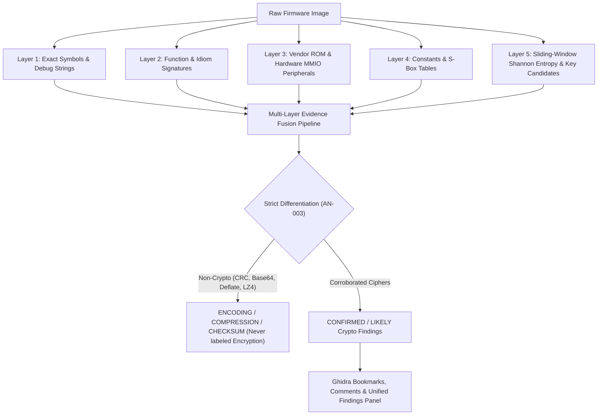

# Embedra

[](LICENSE)
[](https://ghidra-sre.org/)
[](https://openjdk.org/projects/jdk/21/)

**Embedra** is a high-assurance, multi-architecture Ghidra extension engineered for deep embedded firmware reverse engineering, hardware CTF challenges, cryptographic artifact recovery, and silicon security analysis.

Embedra bridges the gap between raw binary captures and high-level architectural understanding across **Espressif (ESP32/ESP8266)**, **STMicroelectronics (STM32 Cortex-M & STM32MP MPU)**, and **Raspberry Pi (RP2040 / RP2350)** platforms.

---

## Table of Contents

- [Core Capabilities](#core-capabilities)
- [Supported Platforms & Architectures](#supported-platforms--architectures)
- [Cryptographic Analysis Engine](#cryptographic-analysis-engine)
- [Security Leads & CTF Recovery](#security-leads--ctf-recovery)
- [Unified Findings, UI & Secret Redaction](#unified-findings-ui--secret-redaction)
- [Firmware & Workspace Diffing](#firmware--workspace-diffing)
- [Local Scanner Plugin API](#local-scanner-plugin-api)
- [Installation](#installation)
- [User Guide & Workflows](#user-guide--workflows)
- [Building from Source](#building-from-source)
- [Governance & Non-Negotiable Invariants](#governance--non-negotiable-invariants)

---

## Core Capabilities

- **Zero-Guess Firmware Ingestion**:
  - Automatically identifies firmware formats from structural byte validation (not filenames or extensions).
  - Merged full-flash captures (ESP32 partition tables, NVS, OTA slots, SPIFFS/LittleFS/FAT).
  - Statically validated container formats: UF2 multi-block payloads, Intel HEX, Motorola S-Record, and raw memory binaries.
  - Multi-image and multi-core container dissection (e.g. bootloader, application slots, coprocessor firmware).
- **Execution Topology & Hardware Mapping**:
  - Models complex multi-core architectures (symmetric SMP, heterogeneous dual-core, radio coprocessors, TrustZone secure/non-secure worlds).
  - Memory-mapped peripheral (MMIO) and volatile register enrichment via verified CMSIS-SVD packs.
  - Offline masked ROM symbol attribution and vector table reconstruction.
- **Layered Cryptographic Artifact Recovery**:
  - Provenance-checked, compiler-, optimization-, and ISA-aware library signature packs across 11 embedded crypto implementations.
  - Constant table matching, sliding-window Shannon entropy analysis, and candidate key identification.
  - Hardware crypto peripheral (AES, SHA, PKA, TRNG) and vendor ROM API call-graph and data-flow detection.
  - Strict differentiation preventing non-crypto tables (CRCs, Base64, Deflate/zlib, LZ4) from being misclassified as encryption ciphers (AN-003).
- **Security Leads, Logging & Panic Recovery**:
  - Recovers assertion strings, panic sites, format strings, and call-site arguments across Thumb, RISC-V, and Xtensa.
  - Ranks security leads: authorization branch decisions, hardcoded credential comparisons, debug shells, and OTA update endpoints.
- **Unified Findings Management & Redaction**:
  - Interactive Swing findings table with multi-criteria filtering, search, and bookmark bi-directional synchronization.
  - Built-in suppression engine with customizable rules.
  - Zero-leak secret masking (`[REDACTED_SECRET]`) enforced by default across JSON, Markdown, and SARIF exports (AN-008).
- **Firmware Workspace Diffing**:
  - Multi-view visual and structural diffing comparing two firmware images across functions, symbols, strings, metadata, memory sections, and partition layouts.
- **Sandboxed Local Plugin Scanner API**:
  - Local plugin SPI with declarative JSON manifests, regex/hex/string matchers, wall-time and allocation boundaries, and ReDoS/infinite loop containment.

---

## Supported Platforms & Architectures

### 1. Espressif Systems (ESP32 & ESP8266)
- **Supported Targets**: ESP32, ESP32-S2, ESP32-S3, ESP32-C2, ESP32-C3, ESP32-C5, ESP32-C6, ESP32-C61, ESP32-H2, ESP32-H21, ESP32-H4, ESP32-P4, and legacy ESP8266.
- **ISA / Languages**: Xtensa LX6/LX7 (`Xtensa:LE:32:default`), custom Embedra `Xtensa:LE:32:esp32s3` language (supporting SALT/SALTU instruction decoding and p-code), and RISC-V 32 (`RISCV:LE:32:default`).
- **Features**:
  - Full-flash parser detecting partition tables, encrypted partitions (treated as opaque), NVS namespaces and keys, and OTA boot states.
  - Provenance-checked ESP-IDF SVD and ROM symbol packs.
  - ESP32-S3 Function ID pilot database (`fid/esp32s3/`) for symbolized reference matching.
  - Hardware crypto detection: AES-128/192/256 ECB/CBC/OFB/CTR/GCM, SHA-1/224/256/384/512, RSA modular exponentiation, Digital Signature (DS), HMAC, TRNG, and eFuse key status.

### 2. STMicroelectronics (STM32 MCU & STM32MP MPU)
- **Supported Targets**:
  - Cortex-M0/M0+/M3/M4/M7/M33/M55 MCU families (STM32F0, F1, F2, F3, F4, F7, G0, G4, H5, H7, L0, L1, L4, L4+, L5, U0, U5, C0, N6).
  - Wireless MCUs: STM32WB, STM32WB0, STM32WBA, STM32WL, STM32WL3.
  - Heterogeneous MPUs: STM32MP13, STM32MP15, STM32MP21, STM32MP23, STM32MP25 (Cortex-A35/A7 + Cortex-M33/M4).
- **Features**:
  - Verified catalog with 53 exact silicon records, pinouts, memory banks, and SVD profiles.
  - Vector table reconstruction and core exception labeling.
  - TrustZone security planning: Secure/Non-Secure memory attribution and Non-Secure Callable (NSC) veneers.
  - Inter-core boot handoff and cross-program shared memory references (SRAM1/SRAM2, IPCC mailbox, HSEM hardware semaphores).
  - Hardware crypto detection: STM32 CRYP (AES, DES, 3DES), HASH (MD5, SHA-1, SHA-224, SHA-256), PKA (ECDSA/RSA), and RNG.

### 3. Raspberry Pi (RP2040 & RP2350)
- **Supported Targets**: RP2040, RP2350A, RP2350B, RP2354A, RP2354B.
- **ISA / Languages**: ARM Cortex-M0+ (`ARM:LE:32:Cortex`), ARM Cortex-M33 (`ARM:LE:32:Cortex-M33`), Hazard3 RISC-V 32 (`RISCV:LE:32:default`).
- **Features**:
  - Validated UF2 boot block ingestion and family ID verification (`RP2040`, `RP2350_ARM_S`, `RP2350_RISCV`, `RP2350_ARM_NS`).
  - Binary Info (`picotool`) header parsing (program name, version, build date, flash/RAM boundaries, GPIO pins).
  - Programmable I/O (PIO) disassembler and state machine analyzer.
  - Boot ROM exported function table resolution via 2-character lookup codes (`RE`, `RP`, `FC`, etc.).
  - RP2350 hardware SHA-256 engine, TRNG sample register, and OTP security memory.

---

## Cryptographic Analysis Engine

Embedra implements a multi-layered cryptographic analysis pipeline (**AN-010**, **AN-011**, **AN-012**, **AN-013**, **AN-014**):



### Supported Cryptographic Primitives & Detection Layers
- **Symmetric Ciphers**: AES-128, AES-192, AES-256 (ECB, CBC, OFB, CTR, GCM), DES, 3DES, ChaCha20, ChaCha20-Poly1305, RC4.
- **Asymmetric Ciphers & Curves**: RSA (modular exponentiation, key structures), Diffie-Hellman, NIST P-256, secp256k1, Curve25519, Ed25519, X25519, ECDSA, ECDH.
- **Cryptographic Hashes & MACs**: MD5, SHA-1, SHA-224, SHA-256, SHA-384, SHA-512, SHA-3 / Keccak, BLAKE2b, BLAKE2s, Poly1305, HMAC, CMAC, HKDF, PBKDF2.
- **Random Generators & Hardware Security**: DRBG / PRNG, Hardware TRNG, Secure Boot Engines, Flash Encryption Controllers, eFuse / OTP Key Ladders, and External Secure Elements (Microchip ATECC608A/B, Infineon OPTIGA Trust M, NXP EdgeLock SE050).
- **Checksums & CRCs (Strictly Non-Encryption)**: CRC-32, CRC-16, CRC-8, Adler-32, Fletcher-16.
- **Encodings & Compression (Strictly Non-Encryption)**: Base64 alphabets, Deflate/zlib headers, LZ4 frame magic.

### Provenance-Checked Signature Database
Embedra contains an embedded, schema-validated (`urn:embedra:schema:crypto-signature-pack:1`) signature database covering **11 embedded crypto libraries**:
`mbed TLS / PSA Crypto`, `wolfSSL`, `BearSSL`, `TinyCrypt`, `Monocypher`, `micro-ecc`, `LibTomCrypt`, `OpenSSL`, `ESP-IDF Crypto`, `STM32 HAL CRYP`, and `Pico SDK`.

Each signature records target architecture (`ARM_THUMB`, `XTENSA`, `RISCV32`), compiler (`GCC`, `CLANG`), optimization level (`O0`-`O3`, `Os`, `Oz`), concrete artifact role (`ALGORITHM_IMPLEMENTATION`, `WRAPPER`, `INLINED_IDIOM`), license provenance, and SHA-256 integrity digests.

---

## Security Leads & CTF Recovery

Embedra analyzes disassembled instructions and control flow to extract actionable security leads without making speculative assertions (**AN-004**, **AN-005**):

- **Comparison Leads**: Tracks call sites to string and memory comparisons (`strcmp`, `strncmp`, `memcmp`, constant-time `mbedtls_ct_memcmp`) where operands reference sensitive tokens (`password`, `admin`, `secret`, `token`, `pin`, `key`, `flag`).
- **Authorization Branches**: Inspects conditional branches (`cbz`, `cbnz`, `beq`, `bne`) immediately following comparisons to identify access control gating decisions.
- **Debug & Admin Commands**: Scans memory tables for command dispatch structures (`{ name, handler, help }`) matching administrative keywords (`root`, `admin`, `debug`, `shell`, `backdoor`, `unlock`, `factory`).
- **Interactive Shells**: Identifies interactive console prompts (`# `, `shell> `, `cli> `, `esp> `) correlated with CLI initialization routines.
- **OTA Endpoints**: Discovers firmware download URLs, MQTT update topics, and update partition references.
- **Panic & Assertion Sites**: Reconstructs assertion failures, panic messages, source file paths, line numbers, and function call arguments.

---

## Unified Findings, UI & Secret Redaction

All discovered entities (cryptographic findings, CTF flags, logging call sites, and security leads) feed into a unified architecture (**AN-006**, **AN-008**):

- **Findings Window**: Access via **Window → Embedra → Unified Findings**.
  - Interactive table supporting column sorting, category filtering, severity filtering, free-text search, and double-click address navigation.
  - Real-time suppression and unsuppression of false positives.
  - Toggle between masked view and revealed view.
- **Secret Redaction (AN-008)**:
  - By default, unmasked secrets are **never** emitted in plain text in logs, bookmarks, or exports.
  - Keys, tokens, and flags are masked (e.g. `4a2f****************************`).
- **Multi-Format Export**:
  - Export findings directly to **JSON**, **Markdown Tables**, or **SARIF 2.1.0** for ingestion into CI/CD security pipelines.

---

## Firmware & Workspace Diffing

Access via **Window → Embedra → Firmware Workspace Diff** (**AN-007**):

- Compare two loaded Ghidra programs or firmware images side-by-side.
- **Multi-View Inspection**:
  - **Function Diff**: Identifies identical, modified, and unique functions based on entrypoint and instruction hashing.
  - **Symbol Diff**: Compares global symbols, labels, and imported routines.
  - **String Diff**: Highlights added, removed, and shared strings and format specifiers.
  - **Memory & Segment Diff**: Visualizes layout and permission changes across memory blocks.
  - **Metadata & Partition Diff**: Compares build descriptions, SDK versions, and partition tables.
- Filter by change status: `ADDED`, `REMOVED`, `MODIFIED`, or `IDENTICAL`.

---

## Local Scanner Plugin API

Users can define custom inspection scanners via a safe local plugin contract (**AN-009**):

- **Declarative Manifests**: Schema-validated (`urn:embedra:schema:scanner-plugin-manifest:1`) JSON files.
- **Supported Matchers**:
  - `REGEX`: Regular expressions with ReDoS input-length limits.
  - `HEX_BYTES`: Byte patterns with wildcards.
  - `EXACT_STRING`: Case-sensitive or insensitive string matching.
  - `ENTROPY`: Windowed Shannon entropy scanning.
- **Sandboxed Execution**:
  - Strict resource budgets (`PluginResourceBudget`): configurable wall-time timeouts (10 ms – 60,000 ms), maximum memory limits, and maximum finding caps.
  - Traps `OutOfMemoryError`, `StackOverflowError`, and hostile infinite loops without crashing Ghidra.

---

## Installation

### Prerequisites
- **Ghidra**: Version **12.1.3 PUBLIC** (pinned baseline).
- **Java**: **JDK 21** (64-bit).

### Extension Installation Steps
1. Download or build the extension ZIP file: `dist/ghidra_12.1.3_PUBLIC_YYYYMMDD_Embedra.zip`.
2. Launch Ghidra.
3. In the Ghidra Project Window, select **File → Install Extensions...**.
4. Click the green **`+`** (Add extension) button in the top right corner.
5. Select the `Embedra.zip` archive.
6. Check the checkbox next to **Embedra** to enable it.
7. Restart Ghidra when prompted.

---

## User Guide & Workflows

### 1. Importing Firmware Images
- **Full Flash Binary (ESP32)**:
  1. Go to **File → Import File...** and select your flash capture.
  2. Ghidra detects the format as `ESP32 Full Flash Image`.
  3. In the Import Options screen, configure whether to extract sub-programs for each bootloader and application slot.
  4. Optionally select `Apply verified target ROM, peripheral, and SVD packs` if the exact chip revision is verified.
- **UF2 Firmware (RP2040 / RP2350)**:
  1. Select your `.uf2` file.
  2. Embedra validates all block checksums and family IDs, creating the appropriate memory blocks and setting up the binary info markers.
- **Raw Binaries (STM32 / Cortex-M)**:
  1. Select your `.bin`, `.hex`, or `.elf` file.
  2. Embedra inspects the initial stack pointer and reset vector, suggesting the correct ARM Cortex-M language and memory base.

### 2. Running Automated Analyzers
In the Ghidra CodeBrowser window, navigate to **Analysis → Auto Analyze '<Program>'...**:
- **Embedra Layered Crypto Analysis**: Scans for crypto tables, candidate keys, entropy, signatures, and hardware peripherals.
- **Embedra Logging & Panic Recovery**: Reconstructs assertions, panic call sites, and format strings.
- **Embedra Security Leads**: Extracts comparison leads, administrative commands, shells, and OTA endpoints.
- **Embedra YARA Scanning**: Executes bundled and custom YARA rules over initialized memory.

### 3. Reviewing Findings & Exporting
1. Open the findings panel: **Window → Embedra → Unified Findings**.
2. Filter findings by category (e.g. `CRYPTOGRAPHY`, `SECURITY_LEAD`) or search for specific terms.
3. Double-click any row to jump immediately to the disassembly address.
4. Click **Export** to save results as JSON, Markdown, or SARIF for reporting.

---

## Building from Source

Embedra uses Gradle with reproducible packaging guarantees.

### Environment Setup
```bash
export JAVA_HOME=/usr/lib/jvm/java-21-openjdk-amd64
export GHIDRA_INSTALL_DIR=/path/to/ghidra_12.1.3_PUBLIC
```

### Build Commands

```bash
# Run pure unit and analyzer test suite (Ghidra independent)
./gradlew pureTest

# Run full quality check (Checkstyle, Unit Tests, Integration Tests, JaCoCo Coverage)
./gradlew check

# Build the Ghidra extension ZIP package
./gradlew buildExtension

# Run full bit-for-bit reproducible packaging and release gate audit
bash scripts/verify-build-quality.sh
```

---

## Governance & Non-Negotiable Invariants

All development in Embedra follows strict engineering principles:

1. **Specification Authority**: `Embedra-SpecKit.md` is the sole source of truth. Task states, acceptance gates, and specification hashes are tracked deterministically in `.embedra/state.json`.
2. **Pure / Adapter Architectural Separation**: Pure analyzers (`core`, `formats`, `targets`, `analyzers`, `svd`, `pack`) must **never** import `ghidra.*` APIs. This separation is strictly verified by `ArchitectureBoundaryTest`.
3. **Bounded Execution**: All parsers and scanners enforce `ParserLimits` (max bytes, max allocations, max object counts, max nesting depth) and cooperative cancellation tokens.
4. **Non-Destructive Modifications**: Applicators must never overwrite or destroy user-defined symbols, primary names, or comments.
5. **Zero Secret Leaking**: Plain-text secret key candidates, tokens, or credentials are masked by default across all reports and UI views (**AN-008**).
6. **Bit-for-Bit Reproducibility**: Builds produce deterministic, byte-identical extension archives across clean consecutive runs.

---

## License

Embedra is licensed under the **Apache License, Version 2.0**. See [LICENSE](LICENSE) for details.
